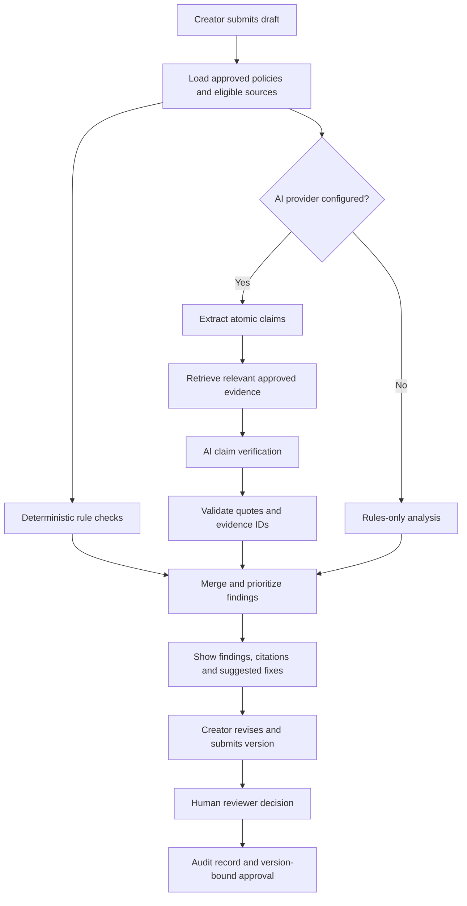

# BrandGuard AI

**Review marketing content against approved brand guidelines, verify claims with traceable evidence, and get human sign-off before publishing.**

[**Live demo**](https://brandguard-ai-pied.vercel.app/) · [**Source code**](https://github.com/Adityaydv1234/BrandGuard-AI) · [**How it works**](#how-it-works) · [**Run locally**](#getting-started)

BrandGuard AI is a full-stack brand compliance and content-review application built for the **Inkloom AI challenge at CodeNexus India 2026**. It helps creators check drafts against an organization's approved facts, terminology, tone, and visual rules, then routes the draft through a review process with documented decisions.

Unlike a generic AI text reviewer, BrandGuard ties its findings to **approved, versioned source material** and validates AI-provided citations before presenting verdicts. Deterministic rules continue to work even when no AI provider is configured.

> **Demo environment:** BrandGuard uses a fictional payments company called **PayNova** with invented policy documents and example drafts. The public demo uses passwordless personas, not production authentication. Avoid entering confidential content.

## See it in action

**[Open the live demo](https://brandguard-ai-pied.vercel.app/)**

Follow this short walkthrough:

1. Sign in as **Priya (Creator)**. Create a draft using the **Risky festive campaign** sample and select **Check draft**.
2. Review each finding, its highlighted text, source citation, and proposed rewrite. Choose **Apply all suggested fixes**, then save the updated version.
3. **Submit for review**, switch to **Arjun (Reviewer)**, and approve the draft or request changes.
4. Return to Priya and edit the approved draft. The previous approval no longer applies to the modified content.
5. Switch to **Meera (Admin)** to manage approved sources, terminology, policy rules, and review insights.

Other samples include a compliant LinkedIn post and an agency email containing an instruction aimed at manipulating the AI reviewer.

<!-- Optional: Add a real 20–40 second screen recording to docs/ and uncomment the line below. -->
<!--  -->

## What it does

| Capability | Implementation |
| --- | --- |
| **Evidence-backed claim review** | Checks claims against approved, effective source documents and displays citations and excerpts alongside findings. |
| **Deterministic compliance checks** | Detects prohibited terminology, risky guarantees, unsupported figures, tone issues, palette violations, missing alt text, and more. |
| **Actionable corrections** | Highlights the relevant span and suggests rewrites; creators can apply individual fixes or all suggestions. |
| **Human approval workflow** | Separates Creator, Reviewer, and Admin permissions. Reviewers can approve, reject, request changes, or document overrides. |
| **Version integrity** | Stores immutable content versions and a content fingerprint; editing approved content invalidates its approval. |
| **Policy management** | Admins manage source status, effective dates, rules, terminology, and brand colours. |
| **Audit and insights** | Records decisions and policy snapshots; surfaces recurring issues, disputes, overrides, and approval patterns. |

### Why the evidence matters

BrandGuard does not treat an LLM's citation as proof. Its verification path applies these constraints:

- A claim quote must occur **verbatim in the submitted draft**; invented quoted text is discarded.
- A `supported` or `contradicted` verdict must reference an **evidence ID actually supplied** to the model; otherwise, the verdict becomes **insufficient evidence**.
- Only **approved, effective** source documents are eligible for evidence retrieval.
- When a deterministic rule covers a span, the rule finding takes precedence.
- Draft and retrieved content are treated as untrusted data, not workflow instructions.

These safeguards reduce specific failure modes; they are **not** a guarantee that all AI verdicts are correct.

## How it works



### Analysis pipeline

**1. Rules first.** Reproducible checks cover prohibited phrases, strong or unsupported claims, superlatives, capitalization, exclamation marks, absent alt text, supplied colour-pair contrast using WCAG 2.2 criteria, off-palette colours, prompt-injection attempts, and numerical values not present in approved sources.

**2. Optional AI verification.** The system extracts atomic claims, retrieves candidate evidence from eligible document chunks, and classifies claims as `supported`, `contradicted`, or `insufficient evidence`. Retrieval uses BM25 and, where configured and supported, embedding similarity.

**3. Review and approval.** High-severity findings block approval unless a reviewer provides a documented override. Creators cannot approve their own drafts. Each decision is recorded with the relevant policy snapshot, and approvals are bound to the exact content fingerprint.

## Technology

| Layer | Technology |
| --- | --- |
| Web app and API | Next.js 14 App Router, React, TypeScript |
| Styling | Tailwind CSS, Public Sans, Source Serif 4 |
| Database | PostgreSQL (`pg`) for hosted environments; PGlite locally |
| Document parsing | `unpdf` for page-aware PDF text, `mammoth` for DOCX; also text, Markdown, and HTML |
| Retrieval | BM25; optional embedding similarity (vectors stored as JSONB, cosine similarity computed in application code) |
| AI integrations | OpenAI or Anthropic APIs; configurable OpenAI-compatible endpoints, including Gemini |
| Auth in demo | Signed HTTP-only session cookie with server-enforced demo roles |
| Hosting | Vercel; hosted PostgreSQL such as Neon |

**Key implementation files:**

- `lib/analysis.ts` — rule engine and AI-assisted checking
- `lib/workflow.ts` — roles, workflow state, and insights
- `lib/repo.ts` — persisted data, source policy context, versions, and audit trail
- `lib/seed.ts` — fictional demo data
- `components/Review.tsx` — findings and evidence interface
- `app/api/` — backend API routes

The main entities include workspaces, users, source documents, source chunks, terminology, rules, submissions, immutable versions, findings, comments, decisions, and audit entries.

## Getting started

**Prerequisite:** Node.js **18.18 or newer**, plus npm.

```bash
git clone https://github.com/Adityaydv1234/BrandGuard-AI.git
cd BrandGuard-AI
npm install
cp .env.example .env.local
npm run dev
```

On Windows PowerShell, use `Copy-Item .env.example .env.local` instead of `cp` if preferred.

Open **http://localhost:3000**.

The app defaults to embedded PGlite and seeds the PayNova demo on first launch. No external database or AI key is required. To reset local seeded data, stop the application and delete the `./.pglite` directory.

### Environment configuration

Copy `.env.example` and set only the values you need:

```dotenv
# Optional AI provider credentials (choose one)
OPENAI_API_KEY=
ANTHROPIC_API_KEY=

# Optional locally; required for persistent serverless deployment
DATABASE_URL=

# Use a long random value for deployment
SESSION_SECRET=replace-with-a-long-random-secret

# Optional model settings
# LLM_PROVIDER=openai
# LLM_MODEL=gpt-4.1-mini
# EMBEDDING_MODEL=text-embedding-3-small
```

**Without an AI key:** BrandGuard operates in disclosed **rules-only mode**. With an OpenAI key, it can use AI-assisted claim verification and embedding-based retrieval. With an Anthropic key alone, it uses BM25 retrieval.

#### Gemini through an OpenAI-compatible endpoint

The application supports configurable OpenAI-compatible endpoints. For Gemini, an example configuration is:

```dotenv
OPENAI_API_KEY=your-gemini-api-key
OPENAI_BASE_URL=https://generativelanguage.googleapis.com/v1beta/openai
LLM_MODEL=gemini-flash-latest
EMBEDDING_MODEL=gemini-embedding-001
```

Check current model availability and provider terms before use. Embedding failures fall back to keyword retrieval. The repository's documented automated verification of this compatibility path used a **local mock**, not a measured live-Gemini accuracy benchmark. Use fictional test content with free-tier services unless the provider's data-handling terms meet your needs.

## Tests

Run the production build and app, then execute the workflow checks from a second terminal:

```bash
npm run build
npm run start
```

```bash
npm test
```

The repository documents **55 workflow, role, and integrity checks**. The separate AI-path suite documents **18 tests against a scripted mock model**, covering failures such as fabricated evidence IDs and invented quotes.

To run the mocked AI-path suite, start the mock service:

```bash
node tests/mock-openai.mjs
```

Then run the application on port **3112**, pointing its OpenAI-compatible configuration at the mock service on port **4010**. In another terminal, execute:

```bash
npm run test:ai
```

These are documented test counts, **not** benchmarked real-model precision or recall. Consult the test scripts for the full mocked-provider setup.

## Deployment

For a persistent hosted deployment (for example, Vercel with Neon PostgreSQL):

1. Provision a PostgreSQL database and obtain its connection string.
2. Import this repository into Vercel.
3. Configure `DATABASE_URL` and a strong `SESSION_SECRET`; add an AI provider key if you want AI-assisted checks.
4. Deploy, open the site in a private browser window, and complete the creator → reviewer → admin walkthrough.

**Important:** Do not rely on embedded PGlite for durable storage on a serverless host. Use `DATABASE_URL` for persistent PostgreSQL. The demo's passwordless personas are not suitable for protecting real organizational content.

## Privacy, security, and scope

- AI credentials are handled on the server. Only submitted text and selected source excerpts needed for verification are sent to the configured AI provider; the entire source library is not sent as one prompt.
- Workspace IDs scope queries, but the demo has only one workspace; multi-tenant isolation has **not** been comprehensively tested.
- Demo login is **not production authentication**. Real deployment would require an identity provider, user provisioning, and access-control hardening.
- The Round 2 submission notes report unresolved dependency security advisories in Next.js 14. **Review `npm audit`, update dependencies, and retest before using the app with real data or promoting it as production-ready.**
- Document extraction does not OCR scanned PDFs. The app reports partially readable documents instead of treating them as fully checked.
- Image file analysis is not implemented; existing colour checks apply to supplied colour pairs and metadata.
- AI claim-checking accuracy has not been measured on a labelled evaluation dataset. No formal user study or assistive-technology accessibility audit has been completed.

## Project background

Developed for the **Inkloom AI problem statement** at **CodeNexus India 2026 (Round 2)**.

**Team InnovaTOR** · **Aditya Yadav — solo developer and project lead**

The codebase was developed with assistance from an AI coding assistant (Claude), then reviewed and tested by the participant. See [`SUBMISSION.md`](./SUBMISSION.md) for the competition-specific scope, verification notes, and proposed follow-up improvements.

---

**Built around one principle: an approval should be explainable, traceable, and valid only for the exact content that was reviewed.**
